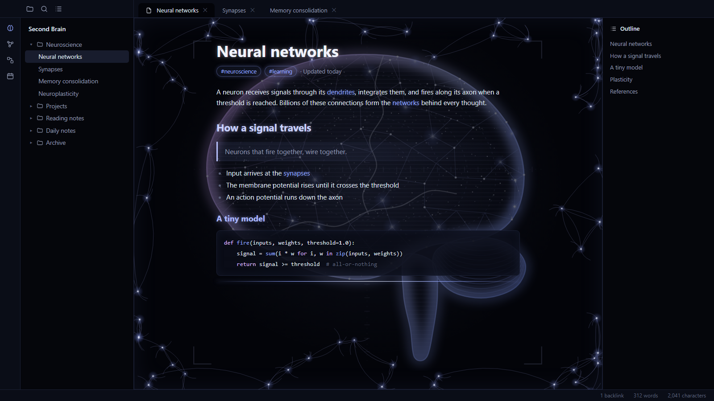
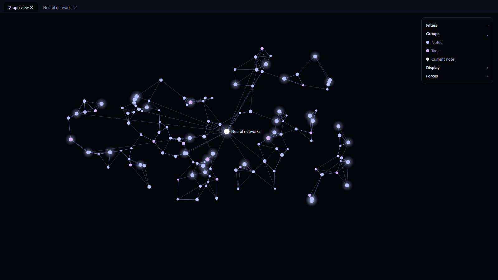

# Brain

A dark Obsidian theme inspired by glowing neural networks: a holographic brain behind every note, and a web of lavender-blue neurons running around the frame.





## Features

- **Holographic brain** in the background of each note: ghostly silhouette with a glowing rim, wireframe mesh, point cloud, scan-like cross sections, scan lines and a measuring reticle. It stays dim so your text remains easy to read.
- **Neural frame**: glowing neurons linked by curved dendrites along the edges of the note, fading towards the center.
- **Deep black background** with lavender, blue and white accents.
- **Glowing headings, links and tags**: headings glow in their own color.
- **Graph view** with lavender nodes and violet connections.
- **Snippet friendly**: no `!important`, so your own CSS snippets always take priority.
- A softer **light mode** is included, but the theme is designed for dark mode.

## Installation

1. Open **Settings → Appearance → Themes → Manage**.
2. Search for **Brain**, then select **Install and use**.
3. Set **Base color scheme** to **Dark** for the full effect.

## Customization

All drawings are SVG images embedded in `theme.css`. They are generated by `tools/build_theme.py` (Python 3.10+, standard library only):

```
python tools/build_theme.py
```

The brain intensity is set by the `opacity` of its main group in `brain()`.

## License

[MIT](LICENSE)
